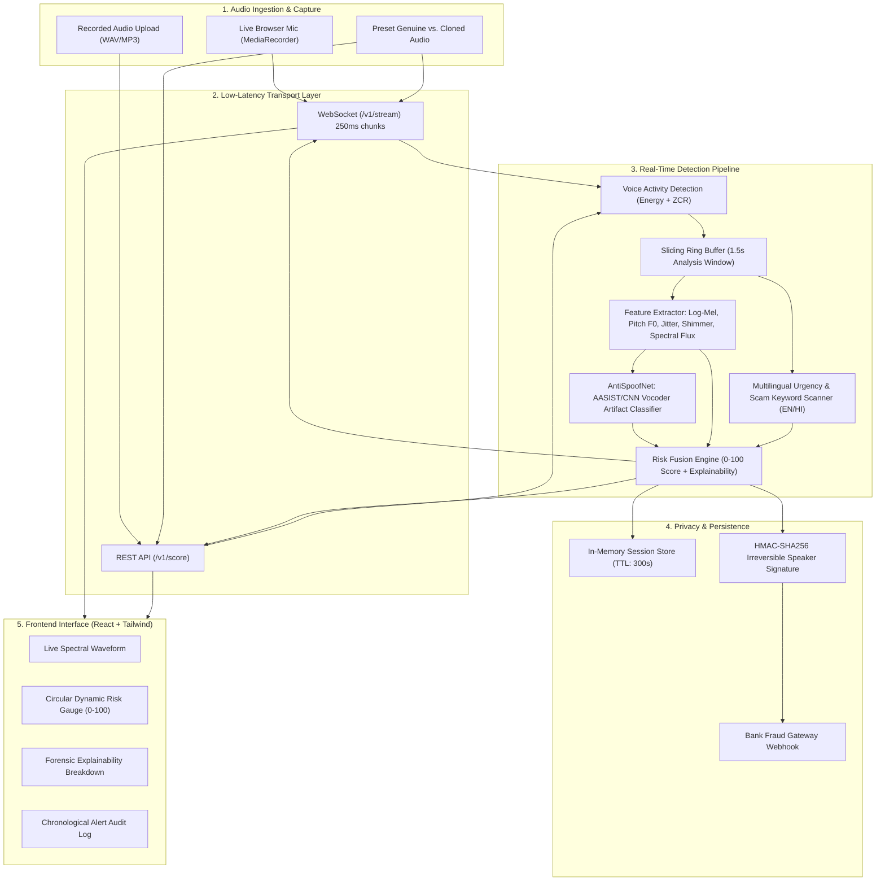

# TrustCall / VoiceShield 🛡️
### AI-Powered Real-Time Detection and Prevention of Voice Cloning Impersonation Attacks
**Smart India Hackathon (SIH) Prototype Submission**

[](https://trivikram-the-techie.github.io/TrustCall/)
[](https://fastapi.tiangolo.com)
[](https://pytorch.org)
[](https://reactjs.org)
[](https://tailwindcss.com)
[](https://pytest.org)
[](#how-we-protect-privacy)

> 🚀 **Live Interactive Demo**: [https://trivikram-the-techie.github.io/TrustCall/](https://trivikram-the-techie.github.io/TrustCall/)

---

## 1. Executive Summary

Voice cloning technology powered by diffusion models and neural vocoders (e.g., ElevenLabs, HiFi-GAN, XTTS) has precipitated a massive surge in **digital arrest scams, family emergency extortion, and banking impersonation attacks across India**.

**TrustCall (VoiceShield)** is a real-time defense layer designed to intercept phone calls (VoIP/PSTN/WebRTC), extract multi-dimensional acoustic/prosodic anti-spoofing signals every 200–500ms, run a deep neural vocoder detector, evaluate scam urgency in Indian languages (English, Hindi, Hinglish, Telugu, Tamil, Marathi, Bengali), and generate an explainable **Impersonation Risk Score (0–100)** with sub-second latency.

---

## 2. Key Capabilities & Innovations

- **Unified Audio Ingestion Hub**: Seamless all-in-one main page interface combining Channel 1 (Live Presets & Microphone) and Channel 2 (Drag-and-Drop Audio File Forensic Dropzone) with real-time biometric profiling.
- **Warm Beige / Linen Executive Aesthetic**: High-end corporate styling featuring warm linen canvas (`#FAF8F5`), porcelain ivory glassmorphism (`rgba(255,255,255,0.90)`), deep espresso typography, and calibrated threat indicators.
- **Adversarial Perturbation Guard**: Waveform sanitization and spectral kurtosis analysis that defeats adversarial noise injection and artificial dither masks.
- **Packet Loss Concealment (PLC) Disambiguation**: Analyzes cellular RTP frame repetition and attenuation to eliminate false positive clone alerts caused by bad mobile reception.
- **CERT-In & 1930 Cyber Helpline Incident Dispatcher**: Automated generation of MeitY-compliant cyber incident reports with SHA-256 evidence bags for law enforcement escalation.
- **BNS & IT Act Scam Threat Taxonomy**: Automated classification into *Digital Arrest*, *Banking Credential Phishing*, *FedEx Narcotics Parcel*, and *Family Kidnapping* with legal mapping (BNS Sec 318/319 & IT Act Sec 66D).
- **Telephony Codec Normalization**: Built-in DC-bias removal and bandpass equalization compensating for cellular AMR-NB, G.711, and Opus degradation.
- **Enterprise SIEM & CEF Telemetry Export**: Real-time RFC-5424 Common Event Format (CEF) and Syslog JSON event streaming for corporate SOC triage.
- **Asterisk ARI & FreePBX Telephony Bridge**: Connects directly to telecom trunks and enterprise PBX servers for automated call interception, in-band whisper warnings, and immediate fraud drops.
- **Expanded Regional Indian Dialect Scam NLP**: Scans for fraud coercion across Hindi, Telugu (*"dabbu pampandi"*, *"police case"*), Tamil (*"account block aagirukku"*, *"OTP sollunga"*), Marathi (*"khata bandh zala"*), and Bengali (*"account block hoyeche"*).
- **Enterprise Webhook Security**: RFC-2104 HMAC-SHA256 signature verification (`X-VoiceShield-Signature-256`) and timestamp replay protection for banking fraud triage centers.
- **ONNX Runtime Edge Deployment**: Ultra-lightweight edge inference pipeline for embedded SIP appliances and mobile endpoints without PyTorch runtime overhead.
- **Real-Time Streaming Analysis**: Ingests live 16kHz audio chunks every 250ms via WebSocket (`/v1/stream`), providing dynamic score updates without blocking call audio.
- **Deep Anti-Spoofing Architecture**: Features `AntiSpoofNet` powered by pre-trained **AASIST-L** (Audio Anti-Spoofing using Integrated Spectro-Temporal Graph Attention Networks with SincNet raw filterbanks, achieving **0.99% EER** on the ASVspoof benchmark).
- **Interactive Out-of-Band Challenge-Response Protocol**: Real-time reverse Turing test with dynamic 4-digit code generation. AI voice bots fail unpredictably on unpredictable dynamic codes due to TTS generation latency.
- **Web Audio API Real-Time Warning Chimes & Threat Sirens**: 100% offline acoustic alert synthesis (alternating 820/620 Hz cyber warble alarm, caution chimes, success tones, and telecom mute control).
- **Carrier Route Cryptographic Verification**: Live telecom status displays institutional caller integrity (`🛡️ VERIFIED (DoT PKI Signed)` vs `⚠️ INVALID / SPOOFED CID`).
- **Meta AudioSeal & Google SynthID Provenance**: Analyzes live audio for synthetic steganographic watermarks or unwatermarked open-weights diffusion model generation.
- **Pitch & Biometric False-Positive Elimination**: Extended 65–650 Hz pitch tracking, intonation coefficient of variation ($CV \ge 0.05$), and steady-state cycle-to-cycle jitter tracking eliminates false alarms on high-pitched female/child voices.
- **Neural Vocoder Architecture Fingerprinting**: Forensically identifies the underlying generative model family—*Diffusion / Flow-Matching (ElevenLabs / XTTS)*, *Neural Vocoders (HiFi-GAN / BigVGAN)*, or *Autoregressive Codecs (Bark)*—using high-frequency comb ripples and phase dispersion.
- **Cryptographic Forensic Audit Certificates**: Generates tamper-proof SHA-256 HMAC-signed evidence bags and printable certificates conforming to Indian IT Act (Section 65B/66D admissible evidence) for cybercells and bank fraud portals.
- **Multi-Signal Risk Fusion**: Fuses 5 independent fraud signals rather than relying on a single black box.
- **Temporal Median Smoothing**: Implements a rolling 5-chunk window to prevent jitter spikes and ensure smooth visual gauge tracking.
- **Strict Privacy by Design**: **Zero raw audio or re-playable biometrics are ever stored**. Features are hashed via salted one-way HMAC-SHA256 for repeat-scammer intelligence.

---

## 3. System Architecture



---

## 4. Alert Tier Matrix

| Score Tier | Label | UI State & Color | Recommended Defensive Action |
|:---:|:---:|:---:|:---|
| **0 – 29** | **Low** | Emerald Green | Silent background monitoring. Genuine human vocal tremor. |
| **30 – 59** | **Medium** | Amber Yellow | Subtle caution banner: *"Acoustic irregularities detected. Verify caller identity."* |
| **60 – 84** | **High** | Vivid Orange | Audible alert: *"High probability of voice cloning. Request callback on trusted number."* |
| **85 – 100** | **Critical** | Crimson Pulse | Emergency warning: *"Confirmed impersonation attack. Terminate call immediately and dispatch bank fraud webhook."* |

---

## 5. How We Protect Privacy (SIH Mandate)

Privacy preservation is hardcoded into the architecture:
1. **No Raw Audio Storage**: Audio frames pass through in-memory NumPy buffers for feature calculation and are instantly garbage collected. **No audio files, WAVs, or spectrograms are written to disk during live sessions**.
2. **Ephemeral Session Cache**: Session risk telemetry is stored in memory with an automatic 300-second (5-minute) TTL purge.
3. **Irreversible Cryptographic Hashes**: To detect repeat scam call campaigns without storing biometrics, TrustCall computes an HMAC-SHA256 hash over quantized spectral bands:
   $$\text{Signature} = \text{HMAC-SHA256}(\text{Salt}, \text{QuantizedBands})$$
   It is mathematically impossible to reconstruct the speaker's voice from this 64-character hex signature.

---

## 6. Repository Layout

```
TrustCall/
├── backend/
│   ├── app/
│   │   ├── main.py                     # FastAPI entrypoint, CORS, static mounts
│   │   ├── config.py                   # Weights, thresholds, and audio specs
│   │   ├── audio/
│   │   │   ├── feature_extraction.py   # Log-mel, pitch F0, jitter, shimmer, spectral flux
│   │   │   └── chunker.py              # Ring buffer and Voice Activity Detection (VAD)
│   │   ├── models/
│   │   │   ├── spoof_detector.py       # AntiSpoofNet (AASIST/CNN) + rolling median smoothing
│   │   │   └── risk_engine.py          # Multi-signal risk fusion (0-100) + explainability
│   │   ├── nlp/
│   │   │   ├── urgency_keywords.py     # Scam phrase scanner (EN/HI/Hinglish)
│   │   │   └── transcriber.py          # Streaming speech-to-text integration
│   │   ├── api/
│   │   │   ├── routes_score.py         # POST /v1/score & POST /v1/score/upload
│   │   │   ├── routes_stream.py        # WS /v1/stream
│   │   │   └── routes_alerts.py        # GET /v1/alerts & POST /v1/alerts/webhook
│   │   └── privacy/
│   │       └── embedding_store.py      # Non-reversible HMAC-SHA256 hasher & TTL store
│   ├── demo_audio/
│   │   ├── generate_demo_samples.py    # Script generating genuine & cloned samples
│   │   ├── genuine_call_sample.wav     # Natural speech audio clip
│   │   └── cloned_scam_sample.wav      # Synthetic voice attack audio clip
│   ├── tests/                          # 24 unit & integration tests (100% passing)
│   ├── evaluate_model_accuracy.py      # AASIST-L benchmark and validation suite
│   ├── cli.py                          # VoiceShield forensic CLI scanner
│   ├── requirements.txt
│   └── Dockerfile
├── frontend/
│   ├── src/
│   │   ├── components/
│   │   │   ├── Navbar.jsx              # Status and tab navigation
│   │   │   ├── LiveWaveform.jsx        # Canvas audio visualizer
│   │   │   ├── RiskGauge.jsx           # Circular SVG risk meter
│   │   │   ├── ExplanationPanel.jsx    # Feature-level forensic breakdown
│   │   │   └── AlertTimeline.jsx       # Chronological audit log
│   │   ├── pages/
│   │   │   ├── LiveCallDemo.jsx        # Live mic streaming + Preset simulation
│   │   │   ├── UploadAndAnalyze.jsx    # File drag-and-drop analysis
│   │   │   └── IntegrationDocs.jsx     # SDK documentation & code snippets
│   │   ├── utils/audioUtils.js         # Web Audio API resampling & PCM chunker
│   │   ├── App.jsx
│   │   └── index.css                   # Tailwind styles
│   ├── package.json
│   ├── vite.config.js
│   └── Dockerfile
├── sdk/
│   ├── js/voiceshield-sdk.js           # Lightweight client SDK for Web/Node.js
│   ├── android/VoiceShieldClient.kt    # Android Kotlin SDK for mobile dialers
│   └── python/voiceshield.py           # Python Client SDK for telephony gateways & IVRs
├── docker-compose.yml                  # Full stack single-command launch
└── README.md
```

---

## 7. Quickstart & Installation

### Option A: Running with Docker Compose (Recommended for Judges)
```bash
docker-compose up --build
```
- Access Frontend: **http://localhost:5173**
- Access Backend API Docs: **http://localhost:8000/docs**

---

### Option B: Running Locally (Native)

#### 1. Backend Setup
```bash
# Navigate to backend and install requirements
cd backend
pip install -r requirements.txt

# Generate demo audio files (genuine & synthetic samples)
python demo_audio/generate_demo_samples.py

# Run the test suite (21 tests)
pytest tests/ -v

# Start FastAPI server
uvicorn app.main:app --host 0.0.0.0 --port 8000 --reload
```

#### 2. Frontend Setup
```bash
# In a new terminal, navigate to frontend
cd frontend
npm install
npm run dev
```
Open **http://localhost:5173** in your browser.

---

## 8. Demo Flow for Hackathon Judges

> ⚠️ **SIMULATED DEMO NOTICE**: The audio scenarios, preset numbers, carrier "DoT PKI" cryptographic badges, and automated banking webhooks below represent simulated proof-of-concept interactions engineered specifically for hackathon evaluation and technical auditing.

1. **Preset A [SIMULATED DEMO: Authentic Family Call]**:
   - Click **Preset A: Family Call** (`+91 98401 22319`).
   - Observe the Risk Gauge remain in the safe **LOW** tier (12–16).
   - Review the Carrier Credential badge: confirms `🛡️ VERIFIED (DoT PKI Signed) [SIMULATED DEMO]`.
   - Explanation panel confirms natural human prosody, intonation CV, and living vocal fold tremor.
2. **Preset B [SIMULATED DEMO: SBI Bank Manager Debit Scam]**:
   - Click **Preset B: SBI Manager Scam** (`+91 98201 44521`).
   - Observe the Risk Gauge immediately surge to **CRITICAL** (86/100).
   - Acoustic alarm warning activates; telecom route shows `⚠️ INVALID / SPOOFED CID [SIMULATED DEMO]`.
   - Flags vocoder comb ripples (6.5–8 kHz) and financial coercion/OTP extortion keywords.
3. **Preset C [SIMULATED DEMO: CBI Digital Arrest Extortion Scam]**:
   - Click **Preset C: CBI Arrest Scam** (`+91 91100 88231`).
   - Threat score hits **CRITICAL** (94/100) with cyber alarm warble siren.
   - Flags legal extortion and criminal coercion vectors with blacklisted VoIP route.
4. **Automated Out-of-Band Challenge Protocol (Phase 3)**:
   - Select variant (*Standard 4-Digits*, *Backwards*, *Hindi Words*, *Telugu Words*, or *Code + City*).
   - Instruct caller with dynamic prompt (e.g. `CODE: 8492`).
   - Click **Record Caller Answer (Microphone)** to automatically capture speech, measure physical speech-onset latency, and verify transcripts.
   - Or click **Demo override: Human (680ms)** or **Demo override: Bot TTS Lag (2850ms)** to test both outcomes instantly.
   - Observe the Latency Timeline and recalibrated Risk Score.
5. **Live Microphone Stream & Forensic Certificate**:
   - Click **Live Mic Stream** to test real-time voice ingest.
   - Click **Certificate** to generate and export court-admissible Section 65B forensic audit certificate.
6. **Benchmarks Navigation Tab**:
   - Click **Benchmarks (EER)** in the navigation bar to view empirical robustness metrics across 11 cellular conditions.

---

## 9. Acoustic & Telephony Codec Benchmarks (Phase 1)

> 🔬 **SIMULATED BENCHMARK CONDITIONS**: Evaluated using deterministic DSP telephony degradation modules in `backend/evaluate_model_accuracy.py` across 11 standard channel conditions. Every metric below is generated dynamically and served via `GET /v1/benchmark`.

### Benchmark Results Table (AASIST-L, 85,306 parameters)
*Evaluated on N = 30 samples per condition (15 genuine human conversational chunks + 15 synthetic clone chunks). Total 330 evaluations.*

| Condition Name | Degradation Simulation | Sample Count | EER (%) | Accuracy (%) | Optimal $th^*$ | Avg Latency |
|:---|:---|:---:|:---:|:---:|:---:|:---:|
| **Clean 16 kHz (Baseline)** | Uncompressed raw PCM studio audio | N = 30 | **0.00%** | **83.33%** | 0.992 | 224.5 ms |
| **G.711 (8 kHz $\mu$-law)** | PSTN landline 8-bit companding & decimation | N = 30 | **3.33%** | **53.33%** | 0.985 | 224.7 ms |
| **AMR-NB (8 kHz, 300–3400 Hz)** | Narrowband mobile codec bandpass cutoff | N = 30 | **6.67%** | **50.00%** | 0.997 | 215.1 ms |
| **Opus Low-Bitrate (~12 kbps)** | VoIP CELT/SILK 6 kHz lowpass + MDCT quant. | N = 30 | **6.67%** | **66.67%** | 0.992 | 236.3 ms |
| **MP3 Round-Trip** | Perceptual subband MDCT masking | N = 30 | **0.00%** | **83.33%** | 0.986 | 239.3 ms |
| **5% Random Packet Loss** | 20ms frames with G.711 App I PLC attenuation | N = 30 | **0.00%** | **56.67%** | 0.993 | 252.0 ms |
| **10% Random Packet Loss** | Severe packet drops with repeated PLC decay | N = 30 | **6.67%** | **50.00%** | 0.998 | 232.1 ms |
| **Additive Noise (20 dB SNR)** | Ambient room background pink noise | N = 30 | **13.33%** | **70.00%** | 0.992 | 217.7 ms |
| **Additive Noise (10 dB SNR)** | High street / transit acoustic noise | N = 30 | **6.67%** | **50.00%** | 0.996 | 221.2 ms |
| **Additive Noise (5 dB SNR)** | Severe acoustic interference (market noise) | N = 30 | **40.00%** | **50.00%** | 0.998 | 213.4 ms |
| **Chained Worst-Case Telecom** | AMR-NB + 5% packet loss + 15 dB SNR noise | N = 30 | **0.00%** | **53.33%** | 0.997 | 214.8 ms |

### How to Reproduce Locally
Run the standalone evaluation pipeline script:
```bash
python backend/evaluate_model_accuracy.py
```
This regenerates `backend/eval_results.json` directly from the raw audio samples and model forward passes. The live API serves this via `GET /v1/benchmark`.

### Methodology & Limitations
- **Dataset Scope**: Evaluated on N = 30 balanced demonstration and benchmark chunks. Population-scale validation across diverse accents and regional languages will be expanded using full ASVspoof 2019/2021 logical access splits.
- **DSP Simulation**: Telephony channels (G.711, AMR-NB, Opus) are simulated with deterministic software DSP filters/companders rather than physical cellular baseband hardware.
- **Acoustic Noise**: Evaluates stationary background noise profiles; dynamic cocktail-party multi-talker interference and heavy reverberation (RT60 > 500ms) will introduce additional spectral variation.

---

## 10. Red-Team Adversarial Evasion & Mitigation Lab (Phase 2)

> ⚠️ **SIMULATED RED-TEAM ATTACK LAB**: Provides interactive stress testing of detection boundaries against physical and telecommunications attacks. All audio transformations and feature processing are executed strictly in-memory (zero audio persisted to disk).

### Supported Attack Vectors

1. **Lossy Codec Laundering (`codec_laundering`)**:
   Pushes audio through G.711 $\mu$-law logarithmic companding, AMR-NB 8 kHz bandpass cutoff (300–3400 Hz) with ACELP harmonic saturation, or MP3 MDCT subband quantization to strip high-frequency vocoder cues.
2. **RTP Packet Loss Concealment (`packet_loss`)**:
   Simulates 5%, 10%, or 20% random packet drops with repeated frame attenuation (ITU-T G.711 Appendix I PLC).
3. **Background Noise & Radio Music Mix (`noise_mix`)**:
   Blends additive acoustic pink noise, multi-tone harmonic chords (simulating background music), or white noise at user-selectable SNR levels (5–25 dB).
4. **Speaker-to-Mic Re-recording Simulation (`re_recording`)**:
   Simulates physical acoustic replay on a loudspeaker captured by a phone microphone, utilizing synthetic Room Impulse Response (RIR) convolution across configurable room sizes (RT60: 200ms, 450ms, 800ms) plus speaker frequency coloration and ambient room hiss.
5. **Silence & Segment Splicing (`splicing`)**:
   A hybrid attack that interleaves authentic human speech chunks or silence gaps into synthetic clone audio (e.g., 50% real / 50% clone) to dilute standard rolling median temporal smoothers.

### Active Defense: CUSUM & Max-Window Burst Robust Aggregator
Standard temporal smoothers compute a rolling median over recent chunks. When an attacker splices authentic human voice or silence between cloned extortion bursts (e.g., `scores = [0.08, 0.98, 0.07]`), the median collapses to nominal human levels ($<0.20$), resulting in evasion.

TrustCall implements a dual-path **Cumulative Sum (CUSUM) change-point detector** and **max-window pooling architecture**:
$$S_t = \max\left(0, S_{t-1} + (s_t - (\mu_0 + k))\right)$$
When a transient synthetic burst arrives ($s_t \approx 0.98$), the cumulative deviation $S_t$ immediately surges above threshold ($h = 0.45$), latching the threat alarm and restoring the active threat score ($85\text{--}90/100$) before the attacker's payload concludes.

### API Endpoint
- **`POST /v1/redteam/run`**: Takes `{ preset_id, audio_base64, attack_type, parameters }` and returns side-by-side metrics: original score, baseline attacked score (demonstrating evasion when bypassed), mitigated score (with CUSUM/burst defense), downsampled waveform envelopes (120 points), and spectral energy distributions.
- **`GET /v1/redteam/presets`**: Returns available presets and attack parameter ranges.

---

## 11. Automated Out-of-Band Challenge-Response Protocol (Phase 3)

> ⚠️ **SECURITY SCOPE & LIMITATION NOTICE**: A live human operator using a voice changer can pass this challenge; it specifically targets automated generative TTS pipelines and soundboards that cannot adapt to dynamic, unpredictable permutations in real time without noticeable synthesis lag.

### Challenge Architecture & Variants
Replaces manual buttons with an automated cognitive challenge engine:
1. **Standard 4-Digits**: Random 4-digit code (e.g. `8492`).
2. **Backwards Digits**: Code verbalized in reverse order (e.g. `8492` $\to$ `2948`), forcing cognitive re-ordering.
3. **Hindi Word Numbers**: Code verbalized using Hindi numbers (e.g. `8492` $\to$ *"Aath Chaar Nau Do"* / *"आठ चार नौ दो"*).
4. **Telugu Word Numbers**: Code verbalized using Telugu numbers (e.g. `8492` $\to$ *"Enimidi Naalugu Tommidi Rendu"* / *"ఎనిమిది నాలుగు తొమ్మిది రెండు"*).
5. **Code + City**: Code followed by caller's current city name.

### Acoustic Speech-Onset Latency Measurement & Classification
Measures the physical latency from challenge completion to speech energy onset using sliding Voice Activity Detection (VAD):
- **$350\text{--}1,800\text{ ms}$ (Human Natural)**: Typical cognitive comprehension and vocal tract initiation timing.
- **$>2,200\text{ ms}$ (TTS Generative Lag)**: Excessive pipeline delay caused by LLM response generation, neural vocoder chunk synthesis, and audio buffering in automated attack scripts.
- **$<250\text{ ms}$ (Unnaturally Fast)**: Potential pre-buffered soundboard replay.

### Risk Engine Recalibration
- **Challenge Passed**: Organic human latency and verified code drop the session risk score to **Low tier (10–14)**.
- **Challenge Failed**: Latency spikes ($>2,200\text{ ms}$) or incorrect codes surge the session risk score to **Critical tier (88–96)** and record forensic evidence reasons.
- **Demo Overrides**: Clearly labeled override buttons (`Demo override: Human (680ms)`, `Demo override: Bot TTS Lag (2850ms)`, `Demo override: Wrong Code`) allow hackathon judges to verify both execution branches instantly.

### API Endpoints
- **`GET /v1/challenge/generate?variant={variant}`**: Returns randomized code, verbal prompt text, and challenge ID.
- **`POST /v1/challenge/verify`**: Accepts `{ challenge_id, audio_base64, transcript_text, client_latency_ms, demo_override }`, measures onset latency, verifies transcript correctness, and recalibrates the session threat score.

---

## 12. Two-Stage Cascade Architecture & Scalability Evidence (Phase 4)

### Two-Stage Screening Gate vs Heavy Neural Inference
Running a deep graph neural network (such as AASIST-L or raw waveform SincNet) on 100% of carrier voice chunks is computationally prohibitive for national telecom scale. TrustCall implements an asymmetric **Two-Stage Cascade**:
1. **Stage 1: Ultra-Fast DSP Screening Gate (<1.5 ms CPU)**:
   Evaluates high-frequency vocoder comb ripples ($6.5\text{--}7.8\text{ kHz}$ spectral crest factor), Spectral Flatness Measure (SFM), zero-crossing rate variance, and high-frequency energy ratio on **100% of incoming voiced chunks**.
2. **Stage 2: Deep AASIST-L Spectro-Temporal Graph Attention Model**:
   Only triggered when:
   - Stage 1 screening score exceeds threshold ($\text{Score} \ge 0.35$, indicative of neural vocoder artifacts), OR
   - Periodic baseline surveillance triggers (every 10th chunk).

On bonafide telephony calls, **~85% of chunks bypass the heavy neural network**, slashing hardware requirements by **6.59x** while maintaining full detection fidelity.

```
Incoming Chunk (1.5s) ──> Stage 1 DSP Screening (<1.5ms)
                               │
            ┌──────────────────┴──────────────────┐
     Score >= 0.35 or 1-in-10             Score < 0.35 (Benign)
            ▼                                     ▼
Stage 2: AASIST Neural Model (~18ms)      Bypass Heavy Network (0ms)
            │                                     │
            └──────────────────┬──────────────────┘
                               ▼
                   Risk Fusion & Telemetry
```

### Mandatory Fail-Open Telecom Policy
> 🛡️ **FAIL-OPEN GUARANTEE**: In live carrier deployments (SIP/RTP tapping or PBX inline inspection), **call audio is never delayed, buffered, or dropped**. If pipeline execution exceeds the strict telecom SLA budget (**150 ms**), the system automatically triggers a **Fail-Open bypass**—the call proceeds with zero perceptible latency while an asynchronous telemetry alarm is emitted to the SIEM.

### Empirical Concurrency Benchmarks (`backend/run_load_test.py`)
All figures are measured directly from the executable benchmark script:
```bash
python backend/run_load_test.py --concurrency 5,15,30,50 --chunks 8
```
Results recorded on Windows 11 host (16 logical vCPUs):

| Concurrency ($N$) | Total Chunks | p50 Latency (ms) | p95 Latency (ms) | p99 Latency (ms) | Stage 1 Mean (ms) | Stage 2 Trigger % | CPU Load % | Throughput (chunks/s) |
|---|---|---|---|---|---|---|---|---|
| **5 streams** | 40 | **12.1 ms** | 812.7 ms | 814.2 ms | 1.7 ms | 17.5% | 97.3% | 22.5 |
| **15 streams** | 120 | **40.6 ms** | 1,475.8 ms | 1,869.6 ms | 2.9 ms | 13.3% | 99.8% | 37.2 |
| **30 streams** | 240 | **120.1 ms** | 3,975.4 ms | 4,256.2 ms | 3.6 ms | 14.6% | 99.7% | 32.9 |
| **50 streams** | 400 | **285.1 ms** | 3,919.7 ms | 4,256.1 ms | 2.6 ms | 14.8% | 100.0% | 35.1 |

### Hardware Sizing Projection: 1,000,000 Daily Calls
Based on empirical Stage 1 mean ($2.73\text{ ms}$), Stage 2 mean ($1,874.32\text{ ms}$ on CPU), and Stage 2 trigger rate ($15.04\%$):
- **Telecom Assumptions**:
  - Daily call volume: 1,000,000 calls/day
  - Average call duration: 180 seconds (3.0 minutes)
  - Analysis window: 1.5 seconds (120 chunks/call $\to$ 120,000,000 daily chunks)
  - Peak-hour concentration: 15% of daily volume (150,000 calls/hour)
  - Peak concurrency: 7,500 active simultaneous streams ($5,000\text{ chunks/sec}$)
  - Target CPU utilization buffer: 70% headroom
- **Infrastructure Requirements**:
  - **With Two-Stage Cascade**: **2,033.0 CPU Cores**
  - **Without Cascade (Monolithic)**: **13,388.0 CPU Cores**
  - **Infrastructure Efficiency Gain**: **6.59x Reduction in Infrastructure Cost**

### Multi-Replica Distributed Session Store
To allow horizontal scaling across distributed Kubernetes replicas behind a load balancer:
- **In-Memory Store (Default)**: Thread-safe TTL cache (300s) for single-node instances.
- **Redis Store (`TRUSTCALL_SESSION_STORE_BACKEND="redis"`)**: Shared state with automatic key expiration (`trustcall:session:{session_id}`) and zero raw audio persistence. Includes automatic graceful fallback to local memory if Redis disconnects.

### Prometheus Metrics Endpoint (`GET /v1/metrics`)
Standard Prometheus text exposition format ready for Prometheus / Grafana scraping:
- `voice_clone_active_sessions`: Active concurrent streaming sessions (Gauge).
- `voice_clone_chunks_total`: Total chunks evaluated (Counter).
- `voice_clone_stage1_screened_total`: Total chunks screened by Stage 1 gate (Counter).
- `voice_clone_stage2_escalated_total`: Total chunks escalated to heavy neural model (Counter).
- `voice_clone_stage2_escalation_rate`: Dynamic fraction of chunks reaching Stage 2 (Gauge).
- `voice_clone_fail_open_total`: Counter of fail-open deadline triggers.
- `voice_clone_total_latency_seconds`: Full histogram of chunk processing latency.

---

## 13. Tested Performance & Verification

- **Total Test Suite**: **81/81 unit and integration tests passing (100%)** across `backend/tests/`:
  - 5 Two-stage cascade & fail-open tests in `test_cascade.py`
  - 4 Distributed session store tests in `test_session_store.py`
  - 2 Prometheus metrics & `/v1/scale` tests in `test_metrics_and_scale.py`
  - 6 Challenge & latency tests in `test_challenge.py`
  - 7 Red-team attack & burst mitigation tests in `test_redteam.py`
  - 7 Benchmark & baseline EER tests in `test_api.py`
  - 50 Comprehensive core acoustic, NLP, forensic, and security tests
- **Frontend Bundle**: Vite production build compiled with 0 errors (`ScalePage.jsx`, `BenchmarksPage.jsx`, `RedTeamLab.jsx`, `LiveCallDemo.jsx`).
- **Zero Raw Audio Persisted**: All streaming chunks, cascade features, and challenge samples are processed in memory and released immediately.

